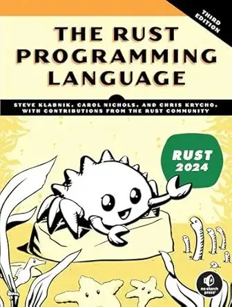

# [Book][Steve Klabnik, Carol Nichols, and Chris Krycho] The Rust Programming Language [ENG, 2026]

https://nostarch.com/rust-programming-language-3rd-edition

 

**Rust Playground:**  
https://play.rust-lang.org/

 

## Contents

<ul>
  <li>:white_check_mark: :book: :hammer_and_wrench: 01. Getting Started</li>
  <li>:white_check_mark: :book: :hammer_and_wrench: 02. Programming a Guessing Game</li>
  <li>:white_check_mark: :book: :hammer_and_wrench: 03. Common Programming Concepts</li>
  <li>:white_check_mark: :book: :hammer_and_wrench: 04. Understanding Ownership</li>
  <li>:white_check_mark: :book: :hammer_and_wrench: 05. Using Structs to Structure Related Data</li>
  <li>:white_check_mark: :book: :hammer_and_wrench: 06. Enums and Pattern Matching</li>
  <li>:white_check_mark: :book: :hammer_and_wrench: 07. Packages, Crates, and Modules</li>
  <li>08. Common Collections</li>
  <li>09. Error Handling</li>
  <li>10. Generic Types, Traits, and Lifetimes</li>
  <li>11. Writing Automated Tests</li>
  <li>12. An I/O Project: Building a Command Line Program</li>
  <li>13. Functional Language Features: Iterators and Closures</li>
  <li>14. More About Cargo and Crates.io</li>
  <li>15. Smart Pointers</li>
  <li>16. Fearless Concurrency</li>
  <li>17. Fundamentals of Asynchronous Programming</li>
  <li>18. Object-Oriented Programming Features</li>
  <li>19. Patterns and Matching</li>
  <li>20. Advanced Features</li>
  <li>21. Final Project: Building a Multithreaded Web Server</li>
</ul>

 

**Videos to Old book version:**

https://www.youtube.com/watch?v=OX9HJsJUDxA&list=PLai5B987bZ9CoVR-QEIN9foz4QCJ0H2Y8
